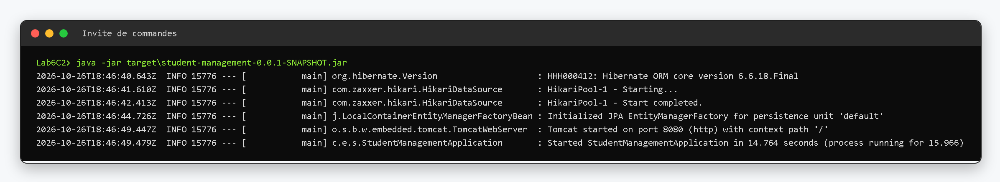
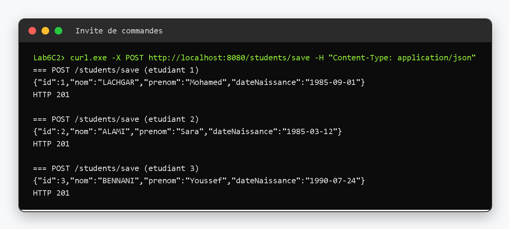
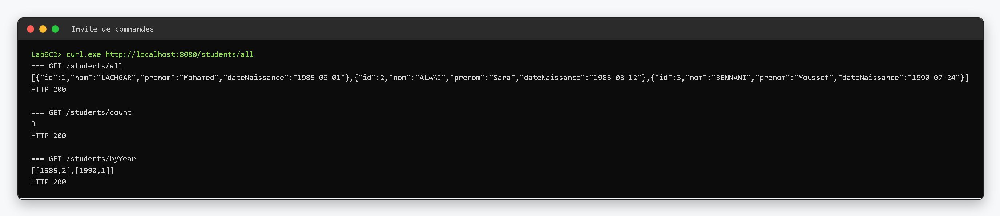
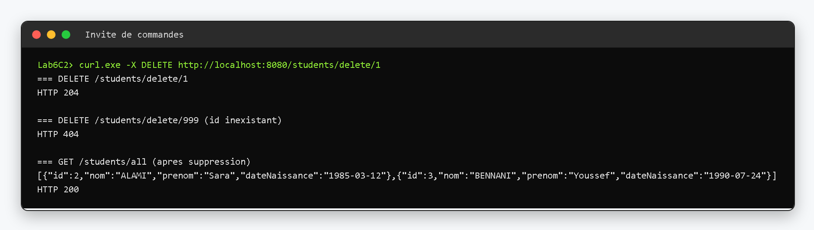
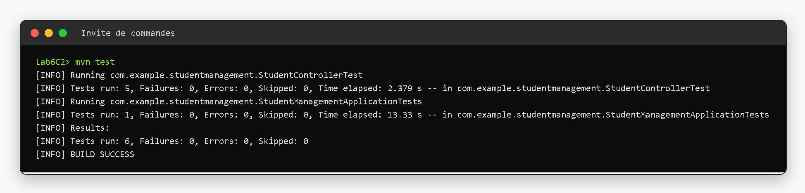
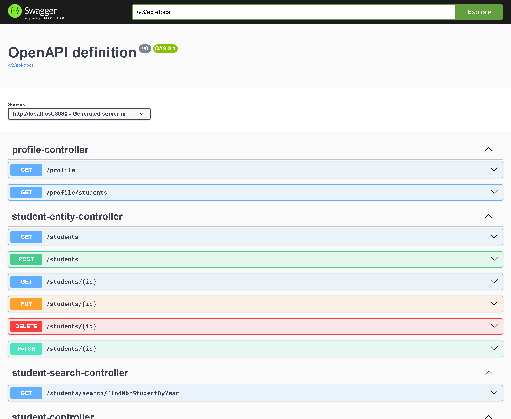

# TP 6 — Spring Boot & Swagger : gestion des étudiants

Petite API REST pour gérer des étudiants, construite avec Spring Boot 3.5, Spring Data JPA et une base MySQL 8.
La documentation des endpoints est générée automatiquement avec springdoc-openapi (Swagger UI).

## Prérequis

- JDK 17 (`java -version`)
- Maven 3.8 ou supérieur (`mvn -version`)
- MySQL 8 sur le port 3306, utilisateur `root` sans mot de passe

## Création de la base

```sql
CREATE DATABASE studentdb;
```

La table `student` n'est pas à créer à la main : `spring.jpa.hibernate.ddl-auto=update` s'en occupe au premier démarrage.
Les paramètres de connexion sont dans `src/main/resources/application.properties` :

```properties
spring.datasource.url=jdbc:mysql://localhost:3306/studentdb?serverTimezone=UTC
spring.datasource.username=root
spring.datasource.password=
spring.jpa.show-sql=true
spring.jpa.properties.hibernate.format_sql=true
spring.jpa.hibernate.ddl-auto=update
springdoc.swagger-ui.path=/swagger-ui.html
```

## Structure

```
Lab6C2
├── pom.xml
├── src/main/java/com/example/studentmanagement
│   ├── StudentManagementApplication.java
│   ├── entity/Student.java              id, nom, prénom, date de naissance
│   ├── repository/StudentRepository.java
│   ├── service/StudentService.java
│   └── controller/StudentController.java
├── src/main/resources/application.properties
├── src/test/java/...                    StudentControllerTest, StudentManagementApplicationTests
└── docs/images                          captures d'exécution
```

## Lancer l'application

```bash
mvn spring-boot:run
```

Ou en passant par le jar :

```bash
mvn clean package
java -jar target/student-management-0.0.1-SNAPSHOT.jar
```

Le serveur écoute sur le port 8080.

## Endpoints

| Méthode | URL | Réponse |
|---|---|---|
| `POST` | `/students/save` | 201 avec l'étudiant enregistré |
| `GET` | `/students/all` | 200 avec la liste des étudiants |
| `GET` | `/students/count` | 200 avec le nombre d'étudiants |
| `GET` | `/students/byYear` | 200 avec le nombre d'étudiants par année de naissance |
| `DELETE` | `/students/delete/{id}` | 204 si supprimé, 404 si l'id n'existe pas |

Exemple de corps pour `/students/save` :

```json
{"nom":"LACHGAR","prenom":"Mohamed","dateNaissance":"1985-09-01"}
```

## Captures d'exécution

Démarrage de l'application : la connexion MySQL est établie et Tomcat écoute sur le port 8080.



Ajout de trois étudiants avec `POST /students/save`, chaque appel renvoie un code 201 et l'étudiant créé avec son `id`.



Lecture des données : la liste complète, le nombre total et la répartition par année de naissance (`[[1985,2],[1990,1]]`).



Suppression de l'étudiant n° 1 (204) puis tentative sur un id inexistant (404), la liste ne contient plus que deux étudiants.



Exécution des tests JUnit 5 / Mockito avec `mvn test` : 6 tests, aucune erreur.



Documentation Swagger générée à partir du contrôleur, accessible sur `http://localhost:8080/swagger-ui.html`.



## Tests

```bash
mvn test
```

`StudentControllerTest` teste les cinq routes du contrôleur avec un `StudentService` simulé par Mockito, et `StudentManagementApplicationTests` vérifie que le contexte Spring démarre correctement (MySQL doit être lancé).
